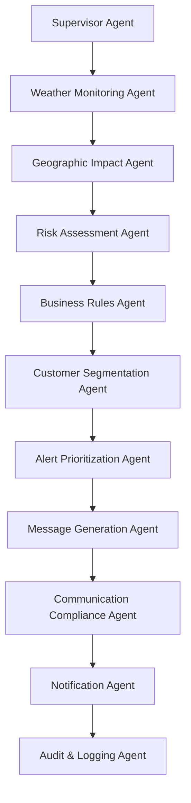
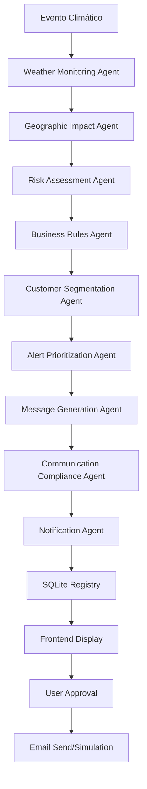

# 🛡️ InsureGuard AI Communications

**MVP — Desafio 5 InsurMinds** | Sistema de Comunicação Proativa com Segurados baseado em Eventos Meteorológicos

[](https://python.org)
[](https://fastapi.tiangolo.com)
[](https://crewai.com)
[](https://react.dev)
[](https://mui.com)
[](https://sqlite.org)
[](https://opensource.org/licenses/MIT)


---

## Visão Geral

O InsureGuard AI Communications é um sistema multi-agente que monitoriza eventos climáticos em tempo real e **notifica proativamente os segurados** afetados. O sistema é capaz de:

1. **Consultar** dados meteorológicos da OpenWeatherMap API
2. **Identificar** eventos de risco (chuva intensa, ciclone, granizo, etc.)
3. **Aplicar** regras de negócio armazenadas em SQLite
4. **Segmentar** segurados afetados por localização e tipo de seguro
5. **Gerar** mensagens personalizadas por IA
6. **Enviar/simular** notificações via Gmail SMTP
7. **Auditar** todo o processo em tempo real

---

## Arquitectura Multi-Agente

O workflow é coordenado por **11 agentes CrewAI** em pipeline sequencial:



---

## Stack Tecnológica

| Camada | Tecnologia |
|---|---|
| Backend | Python 3.12+, FastAPI 0.115, uvicorn |
| Multi-Agent | CrewAI 0.80 |
| Base de Dados | SQLite (SQLAlchemy 2.0 + Alembic) |
| Autenticação | JWT (python-jose), bcrypt (passlib) |
| IA Generativa | OpenRouter API (modelos gratuitos) |
| Meteorologia | OpenWeatherMap API |
| Email | Gmail SMTP (simulação + envio real) |
| Frontend | React 18, TypeScript, Vite 5, Material UI 6 |
| Testes | pytest, httpx, pytest-asyncio |
| Mapas | Leaflet, react-leaflet-markercluster |
---

### Ferramentas de IA e Apoio ao Desenvolvimento Utilizadas

| Ferramenta / Plataforma | Link / Origem | Função e Aplicação no Projeto |
|---|---|---|
| **Google Stitch** | [https://stitch.withgoogle.com/](https://stitch.withgoogle.com/) | Prototipagem rápida de UI/UX e apoio na estruturação visual dos layouts React + Material UI. |
| **Antigravity** | Google DeepMind Agentic Assistant | Pair programming autónomo, refatoração de código, testes de integração automatizados e gestão da documentação técnica e checkpoints. |
| **Claude AI** | [https://claude.ai/](https://claude.ai/) (Anthropic) | Arquitetura de sistemas, engenharia de prompts e *backstories* dos 11 Agentes CrewAI e regras contratuais. |
| **ChatGPT** | [https://chatgpt.com/](https://chatgpt.com/) (OpenAI) | Brainstorming de cenários de desastres, criação de dados mock para `seed.py` e templates empáticos de e-mail/SMS. |

---


## Diagrama de Fluxo de Notificação



## Estrutura do Projecto

```
InsureGuard AI Communications/
├── backend/
│   ├── app/
│   │   ├── agents/             # Definições dos 11 agentes (para referência)
│   │   ├── core/               # Config, autenticação JWT, database engine
│   │   ├── crew/               # InsuranceAlertCrew — pipeline multi-agente
│   │   ├── models/             # SQLAlchemy models (User, Customer, etc.)
│   │   ├── routers/            # FastAPI routers (10 routers: alerts, analytics, audit, auth, business_rules, customers, health, notifications, triggers, weather)
│   │   ├── schemas/            # Pydantic schemas
│   │   ├── tools/              # Integrações: weather, customer, rules, gmail, db
│   │   ├── seed.py             # Dados de exemplo (admin + 10 clientes + 5 regras)
│   │   └── main.py             # FastAPI app entry point
│   ├── tests/                  # pytest — testes automatizados
│   ├── requirements.txt
│   └── .env                    # Variáveis de ambiente (não commitar!)
├── frontend/
│   ├── src/
│   │   ├── api/                # Axios client com interceptors JWT
│   │   ├── components/         # Layout, Sidebar, Topbar, KpiCard, MozambiqueMap, etc.
│   │   ├── pages/              # 15 páginas (Dashboard, Monitoring, RiskMap, Policyholders, Communications, AIAgents, AgentObservability, Analytics, AuditLogs, Documentation, Logs, RiskDiagnostics, Settings, UserManagement, Login)
│   │   └── theme/              # MUI dark/light theme
│   └── package.json

├── planos/                     # Checkpoints e planos de implementação
│   ├── CHK2600001_project_init.md
│   ├── CHK2600002_frontend_base.md
│   ├── CHK2600003_verification.md
│   ├── CHK2600004_e2e_demo.md
│   ├── CHK2600005_production_readiness.md
│   ├── CHK2600006_delivery.md
│   ├── CHK2600007_map_geolocation.md
│   ├── CHK2600008_melhorias_futuras.md
│   └── CHK2600009_risk_triggers_and_real_smtp.md
└── start_all.ps1               # Script para iniciar backend + frontend
```


---

## Instalação

### Pré-requisitos
- Python 3.12+
- Node.js 18+
- Conta OpenWeatherMap (chave API gratuita)
- (Opcional) Conta Gmail com App Password para envio real

### 1. Clonar e preparar ambiente Python

```powershell
cd "d:\Projectos\I2A2\Labs\InsureGuard AI Communications"
python -m venv .venv
.venv\Scripts\Activate.ps1
pip install -r backend/requirements.txt
```

### 2. Configurar variáveis de ambiente

Editar `backend/.env`:

```env
# OpenRouter (IA Generativa) — obrigatório
OPENROUTER_API_KEY=sk-or-...
OPENROUTER_MODEL=google/gemini-2.0-flash-exp:free

# OpenWeatherMap — obrigatório
OPENWEATHERMAP_API_KEY=...

# JWT
SECRET_KEY=insure-guard-secret-key-2026
ALGORITHM=HS256
ACCESS_TOKEN_EXPIRE_MINUTES=60

# Notificações: "simulation" ou "send"
NOTIFICATION_MODE=simulation

# Gmail SMTP (apenas se NOTIFICATION_MODE=send)
GMAIL_USER=
GMAIL_APP_PASSWORD=

# Base de dados
DATABASE_URL=sqlite:///./insurance_alerts.db
```

### 3. Instalar dependências frontend

```powershell
cd frontend
npm install
```

---

## Executar

### Opção 1 — Script Python (Recomendado)

O script Python `run_app.py` na raiz detecta e liberta as portas necessárias, ativa os logs nos arquivos `*.log` e inicia ambos os serviços concorrentemente:

```powershell
# Ativar venv e rodar
python run_app.py

# Para encerrar os serviços, prima Ctrl+C
# Ou para apenas libertar as portas e fechar serviços:
python run_app.py --stop
```

### Opção 2 — Script PowerShell (Windows)

```powershell
# Iniciar serviços
.\start_all.ps1

# Parar serviços
.\start_all.ps1 -Stop
```

### Opção 3 — Manual (Terminais separados)

**Terminal 1 — Backend:**
```powershell
.venv\Scripts\uvicorn.exe app.main:app --port 8000 --app-dir backend
```

**Terminal 2 — Frontend:**
```powershell
cd frontend && npm run dev
```

### Acesso

| Serviço | URL |
|---|---|
| Frontend (React) | http://localhost:5173 |
| Backend API (FastAPI) | http://localhost:8000 |
| Swagger UI (Docs) | http://localhost:8000/docs |

---

## 🔐 Credenciais e Acessos

### Login da Aplicação (Frontend / API)

| Campo | Valor |
|---|---|
| **URL de Login** | http://localhost:5173/login |
| **Email** | `admin@insureguard.com` |
| **Password** | `admin123` |
| **Endpoint JWT** | `POST http://localhost:8000/auth/login` |

> O token JWT retornado pelo `/auth/login` deve ser incluído no header `Authorization: Bearer <token>` em todos os pedidos autenticados.

---

### Configurações do Backend (`.env`)

| Variável | Valor Configurado |
|---|---|
| `SECRET_KEY` | `insureguard-secret-key-change-in-production` |
| `ALGORITHM` | `HS256` |
| `ACCESS_TOKEN_EXPIRE_MINUTES` | `60` |
| `DATABASE_URL` | `sqlite:///./insurance_alerts.db` |
| `NOTIFICATION_MODE` | `real` *(ou `simulation`)* |

---

### Gmail SMTP (Notificações por Email)

| Campo | Valor |
|---|---|
| **Host** | `smtp.gmail.com` |
| **Porta** | `587` |
| **Utilizador (GMAIL_USERNAME)** | `YOUR_GMAIL_USER` |
| **App Password (GMAIL_PASSWORD)** | `YOUR_GMAIL_PASSWORD` |

> Em modo `real`, todos os emails são enviados através desta conta Gmail.

---

### APIs Externas

| Serviço | Chave / Configuração |
|---|---|
| **OpenRouter (IA Generativa)** | `YOUR_OPENROUTER_API_KEY` |
| **Modelo IA** | `google/gemini-2.5-flash` |
| **OpenWeatherMap** | `YOUR_OPENWEATHERMAP_API_KEY` |

---

## Disparar um Alerta Meteorológico

```http
POST http://localhost:8000/weather/monitor-weather
Content-Type: application/json

{"city": "Maputo"}
```

O sistema executa os 11 agentes em sequência e devolve o resultado consolidado com todos os logs de auditoria.

**Cidades e regiões suportadas (Moçambique & Brasil):** Maputo, Beira, Nampula, Pemba, Inhambane, Quelimane, Tete, Chimoio, São Paulo, Rio de Janeiro, Porto Alegre, Recife, Salvador, Curitiba


---

## API — Endpoints Principais

| Método | Endpoint | Descrição |
|---|---|---|
| `GET` | `/health` | Status do sistema |
| `GET` | `/health/db` | Status da base de dados |
| `POST` | `/auth/login` | Login (JWT) |
| `POST` | `/auth/register` | Registo de utilizador |
| `POST` | `/weather/monitor-weather` | Trigger de monitorização de risco |
| `GET` | `/alerts` | Lista de eventos meteorológicos |
| `GET` | `/notifications` | Lista de notificações (suporta filtro por `channel`) |
| `POST` | `/notifications/{id}/approve` | Aprovação de notificação (envio real via SMTP se em modo real) |
| `GET` | `/triggers` | Lista de gatilhos de risco (6 eventos meteorológicos) |
| `GET` | `/triggers/config` | Configurações ativas de SMTP e modo de envio do `.env` |
| `POST` | `/triggers` | Criar novo gatilho de risco |
| `PUT` | `/triggers/{id}` | Editar gatilho de risco e template de mensagem |
| `DELETE` | `/triggers/{id}` | Eliminar gatilho de risco |
| `POST` | `/triggers/{id}/send-test` | Enviar mensagem de teste do gatilho |
| `GET` | `/analytics` | Métricas do dashboard |
| `GET` | `/customers` | Lista de segurados |
| `POST` | `/customers` | Criar segurado |
| `GET` | `/business-rules` | Lista de regras de negócio |
| `GET` | `/audit-logs` | Histórico de auditoria |

Documentação completa: **http://localhost:8000/docs**

---

## Testes Automatizados

```powershell
# Executar todos os testes (da raiz do projecto)
.venv\Scripts\python.exe -m pytest backend/tests/ -v
```

**Resultado esperado:** `6 passed in ~5s`

| Teste | Cobertura |
|---|---|
| `test_health.py` | GET /health, GET /health/db |
| `test_auth.py` | Registo, login, token JWT, /me |
| `test_customers_rules.py` | CRUD clientes e regras de negócio |
| `test_crew.py` | Fluxo completo multi-agente (mock weather) |

---

## Páginas do Frontend

| Rota | Página |
|---|---|
| `/login` | Autenticação |
| `/dashboard` | Risk Command Center (KPIs, mapa, eventos) |
| `/monitoring` | Monitorização de Eventos em Tempo Real |
| `/risk-map` | Mapa de Risco Geográfico |
| `/policyholders` | Gestão de Segurados (CRUD) |
| `/communications` | Fila de Aprovação de Notificações com filtro de canal |
| `/ai-agents` | Visualização do Pipeline Multi-Agente |
| `/audit` | Logs de Auditoria do Sistema |
| `/settings` | Gestão de Gatilhos de Risco, Canais de Notificação (SMTP Real), Regras Globais e Perfil & Segurança |

---

## Modos de Notificação

| Modo | Comportamento |
|---|---|
| `simulation` | Simula o envio, regista no SQLite, sem SMTP real |
| `real` | Envia emails reais via Gmail SMTP (`iajourney.aam@gmail.com`) |

Configurar em `backend/.env`: `NOTIFICATION_MODE=real`


---

## 🎓 Sobre o Projeto

Este projeto foi desenvolvido no âmbito de um curso de especialização, conforme os seguintes dados:

| Campo            | Detalhe                                                 |
| ---------------- | ------------------------------------------------------- |
| **Curso**        | InsurMinds — Inteligência Artificial Aplicada a Seguros |
| **Empresa**      | Instituto de Inteligência Artificial I2A2               |
| **Desafio**      | Desafio 5 — Ferramenta Inteligente para Comunicação Proativa com o Segurado |
| **Grupo**        | IA Journey                                              |
| **Participante** | Arsénio António Monjane                                 |
| **Email**        | monjearse@hotmail.com                                   |
| **Data**         | 13-09-2026                |

---

## Licença

Este projeto está licenciado sob a licença **MIT** — consulte o ficheiro [LICENSE](LICENSE) para mais detalhes.

Projecto académico — **InsurMinds Desafio 5** | 2026

