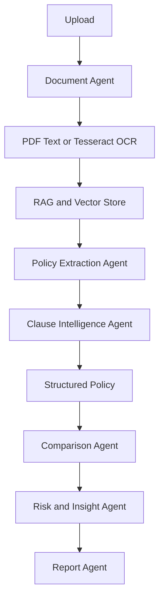

# Prompt Base para Construção do MVP — D&O Intelligence
## Google Antigravity / IDE de Vibecoding

> **Objetivo:** utilizar este documento como prompt mestre/base para construir incrementalmente uma aplicação funcional de MVP para análise e comparação inteligente de apólices D&O.

---

# 1. Papel da IDE

Atue simultaneamente como:

- Senior Full-Stack Engineer
- AI Engineer
- Python/FastAPI Engineer
- React/TypeScript Engineer
- AI Agent Engineer
- UX/UI Engineer
- Software Architect
- QA Engineer

Não crie apenas mockups ou protótipos visuais.

Construa uma aplicação **funcional de ponta a ponta**, executável localmente, modular e preparada para evolução futura.

A aplicação deve demonstrar:

**Documento → OCR/Text Extraction → RAG → Extração estruturada → Classificação de cláusulas → Evidências → Comparação → Insights → Relatório**

---

# 2. Contexto do produto

O projeto chama-se:

**D&O Intelligence**

É um MVP de uma plataforma de IA para análise e comparação de apólices de seguro **Directors & Officers (D&O)**.

As apólices D&O são documentos extensos e complexos, contendo normalmente:

- coberturas;
- exclusões;
- limites;
- sub-limites;
- franquias/deductibles;
- extensões;
- condições;
- períodos de retroatividade;
- períodos de reporte;
- território;
- jurisdição;
- cláusulas especiais;
- obrigações do segurado.

A solução deve reduzir o trabalho manual de localizar, organizar e comparar essas informações.

## Limitação importante

Este é um **MVP académico/técnico**.

Não deve ser apresentado como:

- substituto de um corretor;
- substituto de advogado;
- sistema de decisão automática sobre contratação de seguro;
- sistema que determina objetivamente qual apólice é "melhor".

A IA deve funcionar como **ferramenta de apoio à análise**.

---

# 3. Princípio central

A funcionalidade mais importante do sistema é a rastreabilidade.

Toda informação relevante extraída pela IA deve, quando possível, possuir:

```text
Informação
    ↓
Confiança
    ↓
Documento
    ↓
Página
    ↓
Trecho/Evidência
```

O utilizador deve conseguir responder:

1. O que a IA encontrou?
2. Com que confiança?
3. De qual documento veio?
4. Em que página?
5. Qual trecho suporta a informação?

Evite respostas de IA sem evidência.

---

# 4. Stack tecnológica desta fase

## Frontend

Utilizar:

- React
- TypeScript
- Vite
- Material UI (MUI)
- React Router
- TanStack Query
- Axios
- React Hook Form
- Recharts, apenas quando forem necessários gráficos
- React Testing Library
- Playwright

## Backend

Utilizar:

- Python 3.12+
- FastAPI
- Pydantic v2
- SQLAlchemy
- Alembic
- **SQLite**
- Uvicorn
- pytest

## IA e agentes

Utilizar:

- **LangGraph** para orquestração;
- LLM Provider configurável;
- Mock LLM Provider;
- RAG;
- embeddings;
- ChromaDB.

## Documentos/OCR

Utilizar:

- **PyMuPDF** para PDFs que já possuem texto;
- **Tesseract OCR** como fallback para PDFs digitalizados e imagens;
- `OCRProvider` como abstração;
- `MockOCRProvider` para desenvolvimento/testes.

### Estratégia de processamento documental

Não executar OCR indiscriminadamente.

Fluxo:

```text
PDF
 ↓
PyMuPDF
 ↓
Existe texto?
 ├── SIM → usar texto extraído
 └── NÃO → Tesseract OCR
```

Para JPG/PNG:

```text
Imagem
 ↓
Tesseract OCR
 ↓
Texto por página/documento
```

O texto deve preservar, sempre que possível, a relação com a página de origem.

---

# 5. O que NÃO incluir nesta fase

Para manter o MVP simples e concentrado na funcionalidade, **não implementar agora**:

- Docker
- Docker Compose
- CI/CD
- GitHub Actions
- Redis
- Celery
- RabbitMQ
- Kubernetes
- Prometheus
- Grafana
- infraestrutura cloud
- deployment automatizado

Esses componentes poderão ser adicionados numa fase posterior.

A aplicação deve executar localmente através de processos separados:

```text
Frontend → npm run dev
Backend  → uvicorn
```

SQLite será utilizado como base de dados local.

ChromaDB deverá ser configurado da forma mais simples possível para o ambiente de desenvolvimento.

---

# 6. Harness de agentes

Implementar um **Orchestrator Agent** utilizando preferencialmente **LangGraph**.

O LangGraph deve ser utilizado principalmente para:

- representar o workflow como grafo;
- manter estado;
- controlar transições;
- permitir retries controlados;
- suportar etapas condicionais;
- preparar human-in-the-loop;
- tornar o fluxo observável.

Manter os agentes desacoplados do framework de orquestração sempre que possível.

A arquitetura deve permitir futuramente substituir LangGraph por outro harness sem reescrever a lógica de negócio.

## Regra importante

**Não transformar tudo em agente.**

Utilizar código determinístico para:

- validação de arquivos;
- leitura de PDF;
- contagem de páginas;
- chunking;
- persistência;
- cálculos;
- comparação numérica simples;
- validações de schema;
- controlo de estados.

Utilizar LLM/agentes quando houver necessidade de:

- interpretação;
- classificação;
- extração semântica;
- compreensão de linguagem jurídica;
- síntese;
- comparação qualitativa;
- geração de insights.

---

# 7. Arquitetura dos agentes

Implementar inicialmente:

1. Orchestrator Agent
2. Document Agent
3. Policy Extraction Agent
4. Clause Intelligence Agent
5. Policy Comparison Agent
6. Risk & Insight Agent
7. Report Agent

Fluxo:



---

# 8. Orchestrator Agent

Responsável por coordenar o workflow.

Utilizar um estado semelhante a:

```python
AnalysisState
```

com:

```text
document_id
policy_id
processing_status
extracted_fields
clauses
evidence
comparison
insights
report
errors
```

O Orchestrator deve coordenar os agentes, mas não deve conter toda a lógica de negócio.

---

# 9. Document Agent

Responsabilidades:

- receber documento;
- validar formato;
- armazenar documento;
- identificar número de páginas;
- detectar se existe texto extraível;
- executar OCR quando necessário;
- extrair texto;
- preservar número da página;
- dividir texto em chunks;
- adicionar metadata;
- preparar conteúdo para RAG.

Metadata dos chunks:

```json
{
  "document_id": "uuid",
  "page": 12,
  "chunk_id": "uuid",
  "source": "policy.pdf",
  "text": "..."
}
```

O processamento pode inicialmente utilizar:

```text
FastAPI BackgroundTasks
```

Não introduzir Celery/Redis nesta fase.

---

# 10. OCR

Criar uma abstração:

```python
class OCRProvider:
    def extract_text(self, image):
        ...
```

Implementações:

```text
OCRProvider
   │
   ├── TesseractOCRProvider
   └── MockOCRProvider
```

Para PDFs:

```python
class DocumentTextExtractor:
    def extract(document):
        if has_embedded_text(document):
            return extract_with_pymupdf(document)

        return ocr_with_tesseract(document)
```

Configuração:

```env
OCR_PROVIDER=tesseract
```

ou:

```env
OCR_PROVIDER=mock
```

---

# 11. RAG

Implementar RAG como infraestrutura transversal, não como agente separado.

Pipeline:

```text
PDF
 ↓
PyMuPDF / Tesseract
 ↓
Texto por página
 ↓
Chunks
 ↓
Metadata
 ↓
Embeddings
 ↓
ChromaDB
 ↓
Retriever
 ↓
Relevant Evidence
 ↓
Agents
```

Utilizar inicialmente **ChromaDB**.

Criar uma interface:

```python
class VectorStore:
    def add_documents(...)
    def search(...)
```

Preparar para futura substituição por outro vector store.

---

# 12. Policy Extraction Agent

Transformar texto jurídico em dados estruturados.

Extrair, quando disponível:

### Identificação

- seguradora;
- tomador;
- segurados;
- número da apólice;
- tipo de apólice;
- moeda;
- início;
- término.

### Valores

- limite de responsabilidade;
- limite agregado;
- sub-limites;
- franquia;
- deductible;
- prémio, quando disponível.

### Coberturas

- responsabilidade de administradores;
- custos de defesa;
- investigação regulatória;
- investigação interna;
- cobertura da entidade;
- crise/reputação;
- custos emergenciais;
- extensões;
- antigos administradores;
- herdeiros/representantes.

### Condições

- retroatividade;
- período de reporte;
- território;
- jurisdição;
- obrigações do segurado;
- condições especiais.

Utilizar Pydantic para structured output.

Exemplo:

```json
{
  "field": "liability_limit",
  "value": "USD 5,000,000",
  "confidence": 0.94,
  "page": 18,
  "evidence": "The insurer shall indemnify...",
  "source": "policy_a.pdf"
}
```

---

# 13. Clause Intelligence Agent

Identificar e classificar cláusulas.

Categorias:

- Coverage
- Exclusion
- Limitation
- Deductible
- Sublimit
- Condition
- Extension
- Obligation
- Definition
- Special Clause

Estrutura:

```json
{
  "category": "Exclusion",
  "name": "Prior Acts Exclusion",
  "description": "...",
  "importance": "high",
  "confidence": 0.92,
  "page": 27,
  "evidence": "...",
  "source": "policy_a.pdf"
}
```

---

# 14. Comparison Agent

Comparar duas apólices.

Comparar pelo menos:

- limite de responsabilidade;
- limite agregado;
- franquia;
- custos de defesa;
- investigação regulatória;
- investigação interna;
- cobertura da entidade;
- crise/reputação;
- extensões;
- exclusões;
- retroatividade;
- período de reporte;
- território;
- jurisdição;
- condições especiais.

A comparação deve combinar:

1. comparação determinística dos dados estruturados;
2. interpretação semântica através do LLM quando necessário.

Não usar LLM para cálculos numéricos que possam ser realizados pelo backend.

Exemplo:

```json
{
  "criterion": "Liability Limit",
  "policy_a": "USD 5M",
  "policy_b": "USD 10M",
  "difference": "USD 5M",
  "impact": "...",
  "severity": "high",
  "evidence_a": {},
  "evidence_b": {}
}
```

---

# 15. Risk & Insight Agent

Transformar diferenças em informação compreensível.

Preferir:

> "A Apólice B apresenta limite superior neste critério."

Evitar:

> "A Apólice B é melhor."

Os insights devem ser:

- explicáveis;
- baseados nos dados;
- associados às evidências;
- sem conclusões absolutas.

---

# 16. Report Agent

Gerar:

1. Identificação das apólices;
2. Resumo executivo;
3. Principais diferenças;
4. Tabela comparativa;
5. Coberturas;
6. Exclusões;
7. Limites;
8. Franquias;
9. Cláusulas relevantes;
10. Pontos de atenção;
11. Evidências;
12. Limitações da análise.

Nesta fase:

- HTML;
- JSON estruturado;
- impressão pelo browser.

PDF poderá ser acrescentado posteriormente.

---

# 17. Modelo de dados

Utilizar SQLAlchemy + **SQLite**.

## Document

```text
id
filename
file_path
mime_type
page_count
status
created_at
```

## Policy

```text
id
document_id
policy_number
insurer
policyholder
currency
start_date
end_date
liability_limit
deductible
status
created_at
```

## PolicyField

```text
id
policy_id
field_name
value
confidence
page
evidence
source
```

## Clause

```text
id
policy_id
category
name
description
importance
confidence
page
evidence
source
```

## Comparison

```text
id
policy_a_id
policy_b_id
summary
created_at
```

## ComparisonItem

```text
id
comparison_id
criterion
value_a
value_b
difference
impact
severity
evidence_a
evidence_b
```

---

# 18. API

Criar endpoints:

```text
POST   /api/documents/upload
GET    /api/documents
GET    /api/documents/{id}
POST   /api/documents/{id}/process
GET    /api/documents/{id}/status

GET    /api/policies
GET    /api/policies/{id}
GET    /api/policies/{id}/fields
GET    /api/policies/{id}/clauses
GET    /api/policies/{id}/evidence

POST   /api/comparisons
GET    /api/comparisons
GET    /api/comparisons/{id}

POST   /api/reports/comparison/{id}
```

Endpoints devem chamar services/orchestrators e não conter diretamente lógica LLM.

---

# 19. Interface React

Criar interface B2B/InsurTech:

- moderna;
- limpa;
- corporativa;
- responsiva;
- foco em informação;
- boa hierarquia visual.

Paleta:

- navy/azul;
- branco;
- cinza;
- verde;
- amarelo;
- vermelho.

---

# 20. Navegação

Sidebar:

```text
Dashboard
Apólices
Nova Análise
Comparações
Relatórios
Histórico
Configurações
```

Topbar:

- título;
- breadcrumb;
- pesquisa;
- notificações;
- perfil.

---

# 21. Dashboard

Mostrar:

- Apólices analisadas;
- Documentos processados;
- Comparações realizadas;
- Análises com alertas;
- análises recentes;
- atividade recente.

---

# 22. Nova Análise

Criar upload drag-and-drop.

Aceitar:

```text
PDF
PNG
JPG
JPEG
```

Mostrar pipeline:

```text
Documento recebido
        ✓
Extração de texto
        ✓
OCR, se necessário
        ✓
Identificação de cláusulas
        ...
Análise IA
        ...
Estruturação
        ...
Concluído
```

---

# 23. Detalhe da Apólice

Mostrar:

- Seguradora;
- Tomador;
- Período;
- Limite;
- Franquia;
- confiança geral.

Tabs:

```text
Resumo
Coberturas
Exclusões
Limites
Franquias
Cláusulas
Partes
Evidências
```

Cada campo relevante:

```text
Valor
Confiança
Página
Ver evidência
```

---

# 24. Evidence Viewer

Visualização dividida:

```text
┌──────────────────────────┬──────────────────────────┐
│ Documento / Página       │ Informação extraída      │
│                          │                          │
│ Texto destacado         │ Limite: USD 5M           │
│                          │ Confiança: 94%            │
│                          │ Página: 18               │
│                          │                          │
│                          │ [Ver no documento]        │
└──────────────────────────┴──────────────────────────┘
```

A informação apresentada pela IA deve possuir uma fonte sempre que possível.

---

# 25. Comparação

Criar:

```text
Comparar Apólices
```

Selecionar:

```text
Apólice A
Apólice B

[Comparar com IA]
```

Mostrar:

- resumo;
- tabela comparativa;
- principais diferenças;
- severidade;
- impacto;
- evidências.

---

# 26. Evidência comparativa

Permitir:

```text
APÓLICE A                 APÓLICE B

Página 18                 Página 21

[evidência]               [evidência]
```

Esta é uma funcionalidade central do MVP.

---

# 27. Histórico

Mostrar:

- documentos;
- apólices;
- comparações;
- datas;
- status.

---

# 28. Relatório

Página:

```text
D&O INTELLIGENCE

RELATÓRIO COMPARATIVO

Apólice A
vs.
Apólice B

Resumo Executivo

Principais Diferenças

Tabela Comparativa

Pontos de Atenção

Evidências

Limitações
```

Adicionar:

```text
[Imprimir]
[Exportar]
```

---

# 29. Demo Mode

Criar dados fictícios:

```text
D&O Policy A
D&O Policy B
```

Os dados devem ser claramente identificados como:

> Dados fictícios para demonstração.

Criar diferenças suficientes para demonstrar:

- limites;
- franquias;
- coberturas;
- exclusões;
- retroatividade;
- período de reporte;
- cláusulas.

---

# 30. Mock AI Provider

O sistema deve funcionar sem API externa de LLM.

Criar:

```python
class LLMProvider:
    def generate(...)
```

Implementar:

```text
MockLLMProvider
OpenAIProvider
```

Configuração:

```env
LLM_PROVIDER=mock
LLM_MODEL=
OPENAI_API_KEY=
```

Nunca colocar API keys no frontend.

---

# 31. Estrutura do projeto

```text
do-intelligence/
│
├── frontend/
│   ├── src/
│   │   ├── components/
│   │   ├── pages/
│   │   ├── layouts/
│   │   ├── hooks/
│   │   ├── services/
│   │   ├── types/
│   │   └── utils/
│   ├── tests/
│   ├── package.json
│   └── vite.config.ts
│
├── backend/
│   ├── app/
│   │   ├── api/
│   │   ├── agents/
│   │   ├── core/
│   │   ├── models/
│   │   ├── schemas/
│   │   ├── services/
│   │   ├── repositories/
│   │   └── rag/
│   ├── tests/
│   ├── requirements.txt
│   └── alembic.ini
│
├── data/
├── uploads/
├── .env.example
├── .gitignore
└── README.md
```

---

# 32. Contratos e schemas

Criar schemas Pydantic para todos os outputs dos agentes.

Exemplo:

```python
class ExtractedField(BaseModel):
    field: str
    value: str | None
    confidence: float
    page: int | None
    evidence: str | None
    source: str | None
```

Se a saída do LLM não respeitar o schema:

1. tentar corrigir/revalidar;
2. realizar retry controlado;
3. registrar o erro;
4. não gravar dados inválidos.

---

# 33. Estados do processamento

Utilizar:

```text
UPLOADED
PROCESSING
OCR_PROCESSING
EXTRACTING
ANALYZING
COMPLETED
FAILED
```

O frontend deve refletir esses estados.

---

# 34. Tratamento de erros

Implementar:

- retries limitados para chamadas de IA;
- timeout;
- tratamento de PDF inválido;
- tratamento de OCR falhado;
- tratamento de LLM indisponível;
- validação de structured output;
- logs de erro;
- estado FAILED com mensagem amigável.

Não esconder erros silenciosamente.

---

# 35. Observabilidade inicial

Nesta fase, manter observabilidade simples.

Implementar logging estruturado ou organizado com:

```text
timestamp
document_id
policy_id
comparison_id
agent
status
duration
error
```

Registar eventos:

```text
document_received
document_processed
ocr_started
ocr_completed
extraction_started
extraction_completed
clause_analysis_started
comparison_started
comparison_completed
report_generated
agent_error
```

Não implementar Prometheus, Grafana ou tracing distribuído nesta fase.

Preparar a arquitetura para futura integração com OpenTelemetry.

---

# 36. Testes

Implementar testes suficientes para garantir o funcionamento do MVP.

## Backend

Usar pytest para:

- chunking;
- schemas;
- parsing;
- cálculos;
- regras de comparação;
- services;
- endpoints FastAPI;
- integração SQLite;
- contratos dos agentes.

## Frontend

Usar React Testing Library para:

- componentes principais;
- estados de processamento;
- tabelas;
- formulários;
- visualização de evidências.

## E2E

Usar Playwright para o fluxo principal:

```text
Abrir aplicação
    ↓
Upload de duas apólices
    ↓
Processar
    ↓
Visualizar apólices
    ↓
Selecionar duas
    ↓
Comparar
    ↓
Ver diferenças
    ↓
Ver evidência
    ↓
Gerar relatório
```

Não criar ainda uma infraestrutura de CI para executar estes testes.

---

# 37. AI Evaluation

Criar um pequeno conjunto de documentos/dados "golden".

Avaliar:

- correção da extração;
- validade do schema;
- presença de evidência;
- página correta;
- precisão da comparação;
- ausência de afirmações sem suporte.

Para campos críticos:

```text
liability_limit
deductible
policy_period
```

definir valores esperados.

Não considerar apenas se a resposta "parece correta".

---

# 38. Segurança básica

Implementar:

- validação MIME/type;
- limite de tamanho;
- nomes de ficheiros seguros;
- CORS configurável;
- `.env`;
- secrets fora do código;
- sanitização;
- tratamento de exceções;
- nunca enviar API keys ao frontend.

Não guardar conteúdo sensível nos logs.

---

# 39. Configuração de ambientes

Criar:

```text
.env.example
```

Exemplo:

```env
APP_ENV=development

LLM_PROVIDER=mock
LLM_MODEL=

OPENAI_API_KEY=

DATABASE_URL=sqlite:///./data/do_intelligence.db

VECTOR_STORE=chroma

UPLOAD_DIR=./uploads

OCR_PROVIDER=tesseract

CORS_ORIGINS=http://localhost:5173
```

---

# 40. Frontend e backend

Manter frontend e backend desacoplados.

O frontend nunca deve conhecer:

- SQL;
- lógica de agentes;
- chaves de API;
- prompts internos.

O frontend comunica apenas com a API FastAPI.

---

# 41. Regras de implementação para Vibecoding

Não gerar centenas de ficheiros de uma vez.

Implementar incrementalmente.

Antes de cada grande etapa:

1. verificar o estado atual do projeto;
2. identificar o que já existe;
3. reutilizar código existente;
4. evitar duplicação;
5. implementar apenas a próxima capacidade necessária;
6. executar testes;
7. corrigir erros;
8. atualizar documentação.

**Não apagar ou substituir funcionalidades existentes sem justificar a alteração.**

---

# 42. Roadmap enxuto

## Fase 1 — Foundation

Construir:

- React;
- Vite;
- MUI;
- FastAPI;
- SQLite;
- SQLAlchemy;
- Alembic;
- layout;
- routing;
- Dashboard;
- comunicação frontend/backend.

**Critério:**

> A aplicação abre e frontend/backend comunicam corretamente, com persistência em SQLite.

---

## Fase 2 — Documentos

Implementar:

- upload;
- armazenamento;
- metadata;
- PyMuPDF;
- detecção de PDF com/sem texto;
- Tesseract OCR;
- Mock OCR;
- status de processamento.

**Critério:**

> O utilizador consegue carregar um PDF e obter texto associado às páginas.

---

## Fase 3 — RAG

Implementar:

- chunking;
- embeddings;
- ChromaDB;
- retrieval;
- metadata;
- evidências.

**Critério:**

> É possível localizar informação relevante e respetiva origem.

---

## Fase 4 — Policy Intelligence

Implementar:

- Orchestrator;
- Policy Extraction Agent;
- Pydantic structured outputs;
- Clause Intelligence Agent;
- MockLLMProvider.

**Critério:**

> Uma apólice produz dados estruturados com confiança, página e evidência.

---

## Fase 5 — Evidence Viewer

Implementar:

- detalhe da apólice;
- campos extraídos;
- confiança;
- página;
- trecho;
- evidência.

**Critério:**

> O utilizador consegue verificar a origem da informação.

---

## Fase 6 — Comparison

Implementar:

- seleção A/B;
- Comparison Agent;
- comparação determinística;
- comparação semântica;
- diferenças;
- evidências A/B.

**Critério:**

> Duas apólices podem ser comparadas de ponta a ponta.

---

## Fase 7 — Insights e Report

Implementar:

- Risk & Insight Agent;
- pontos de atenção;
- resumo executivo;
- Report Agent;
- relatório HTML;
- impressão/exportação.

**Critério:**

> O sistema transforma diferenças em explicações rastreáveis e apresenta um relatório.

---

## Fase 8 — Quality

Implementar:

- testes unitários;
- testes de integração;
- Playwright;
- AI evaluation;
- logging;
- documentação;
- refinamento da UX.

**Critério:**

> O fluxo principal do MVP funciona de forma reproduzível e demonstrável.

---

# 43. Critério final de sucesso

O MVP estará concluído quando for possível executar:

```text
1. Abrir a aplicação
        ↓
2. Fazer upload de duas apólices
        ↓
3. Processar documentos
        ↓
4. Extrair texto/PyMuPDF ou OCR
        ↓
5. Indexar no RAG
        ↓
6. Extrair dados estruturados
        ↓
7. Classificar cláusulas
        ↓
8. Visualizar evidências
        ↓
9. Selecionar duas apólices
        ↓
10. Comparar com IA
        ↓
11. Visualizar diferenças
        ↓
12. Ver evidências A/B
        ↓
13. Ver pontos de atenção
        ↓
14. Gerar relatório
```

---

# 44. Regra de qualidade mais importante

Não construir uma "demo de IA" em que o frontend mostra respostas fictícias sem backend real.

Mesmo que algumas capacidades inicialmente utilizem mocks, a arquitetura deve ser real:

```text
React
  ↓
FastAPI
  ↓
Orchestrator / LangGraph
  ↓
Agents
  ↓
Services
  ↓
SQLite + ChromaDB
  ↓
Evidence
  ↓
React
```

Os mocks devem estar atrás de interfaces substituíveis.

---

# 45. Regra para prompts dos agentes

Os prompts internos dos agentes devem:

- ser versionáveis;
- ficar separados do código;
- exigir structured output;
- exigir evidência;
- evitar hallucination;
- não inventar informações;
- indicar quando não foi encontrada evidência;
- preservar página e documento.

Quando a informação não estiver disponível:

```text
value = null
confidence = 0
evidence = null
```

Não preencher com suposições.

---

# 46. Documentação

Criar um `README.md` contendo:

- objetivo;
- arquitetura;
- stack;
- instalação;
- configuração;
- execução;
- API;
- agentes;
- RAG;
- OCR;
- modelo de dados;
- testes;
- Demo Mode;
- configuração do LLM;
- limitações;
- roadmap.

Adicionar:

```text
docs/
├── architecture.md
├── agents.md
├── api.md
├── testing.md
└── evaluation.md
```

Não criar documentação de deployment nesta fase.

---

# 47. Resultado esperado

O resultado deve ser uma aplicação MVP profissional e demonstrável que mostre:

### Engenharia de software

- React;
- FastAPI;
- SQLAlchemy;
- SQLite;
- REST;
- testes.

### Inteligência Artificial

- LLM;
- structured outputs;
- agentes;
- LangGraph;
- RAG;
- embeddings;
- ChromaDB.

### Processamento documental

- PyMuPDF;
- Tesseract OCR;
- evidências por página.

### Agentic workflow

```text
Orchestrator
    ↓
Document Agent
    ↓
Policy Extraction
    ↓
Clause Intelligence
    ↓
Comparison
    ↓
Risk & Insight
    ↓
Report
```

### Diferencial

> **Não basta a IA responder. A IA deve conseguir mostrar de onde veio a resposta.**

O foco do MVP é:

**Documento → Evidência → Estrutura → Comparação → Insight**

---

# 48. Primeira instrução para iniciar o projeto

Antes de escrever código:

1. Inspecione o workspace atual;
2. Verifique se já existem ficheiros;
3. Não sobrescreva código existente sem necessidade;
4. Apresente uma breve análise da arquitetura proposta;
5. Crie um plano de implementação em fases;
6. Identifique dependências;
7. Comece apenas pela **Fase 1 — Foundation**.

Depois de implementar cada fase:

- execute os testes;
- valide frontend/backend;
- corrija erros;
- atualize README;
- só então avance para a próxima fase.

**Não implemente todas as fases de uma vez.**

A prioridade é obter primeiro uma base executável, testável e incrementalmente evolutiva.
