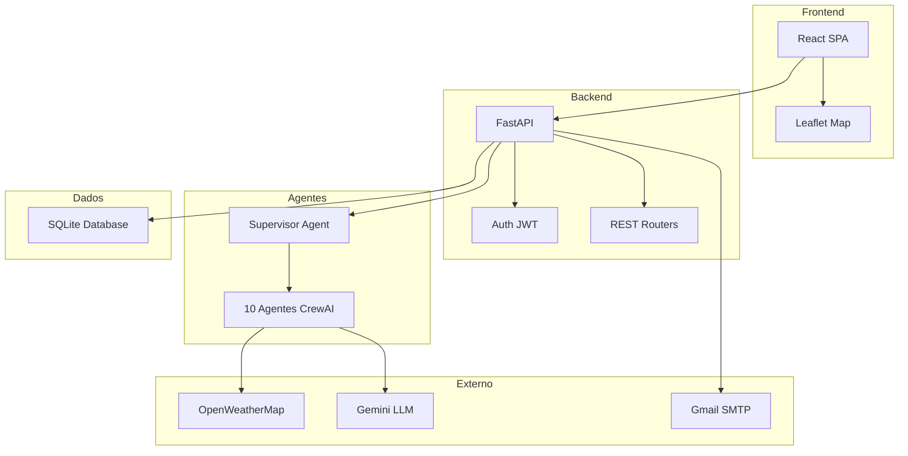
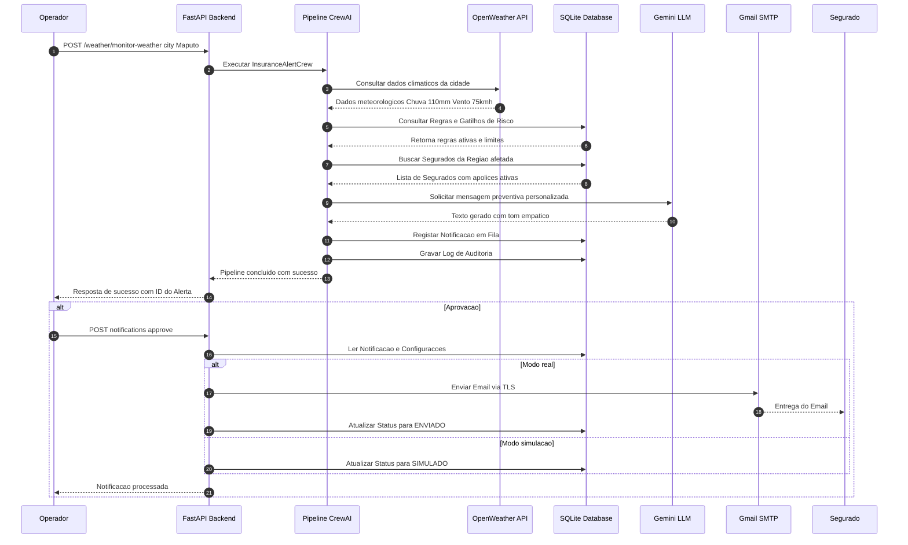

# 📄 Relatório Técnico: InsureGuard AI Communications

---

### 🎓 Identificação do Projeto

| Campo | Detalhe |
| :--- | :--- |
| **Curso** | InsurMinds — Inteligência Artificial Aplicada a Seguros |
| **Instituição** | Instituto de Inteligência Artificial (I2A2) |
| **Desafio** | Desafio 5 — Ferramenta Inteligente para Comunicação Proativa com o Segurado |
| **Grupo** | IA Journey |
| **Participante** | Arsénio António Monjane |
| **Email** | monjearse@hotmail.com |
| **Data** | 13-09-2026 |
| **Versão** | 1.0.0 (MVP Produção) |

---

## 1. 🎯 Resumo Executivo

O **InsureGuard AI Communications** é uma plataforma inteligente e autónoma desenvolvida para o setor de seguros, cujo objetivo principal é transformar a postura tradicionalmente reativa das seguradoras numa **estratégia proativa de mitigação de sinistros** com cobertura internacional focada no **Brasil e em Moçambique**. 

Através da monitorização contínua de condições meteorológicas extremas (chuvas intensas, ciclones, inundações, tempestades e ondas de calor), o sistema aciona um pipeline multi-agente alimentado por Inteligência Artificial Generativa. Este pipeline identifica os segurados em risco geográfico em ambos os países, avalia a cobertura das suas apólices, gera comunicações hiper-personalizadas e expediciona alertas via e-mail real (SMTP Gmail) ou SMS, mantendo rastreabilidade total em base de dados SQLite.

---

## 2. 🏛️ Arquitetura da Solução

A solução foi projetada utilizando uma arquitetura modular em camadas, separando claramente a interface do utilizador (Frontend SPA), a camada de orquestração de serviços e APIs (Backend FastAPI), o motor de raciocínio autónomo (Pipeline Multi-Agente CrewAI) e os repositórios de dados e integrações externas.

### 2.1 Diagrama de Arquitetura do Sistema

---

## 3. 🤖 Descrição dos Agentes Desenvolvidos

O motor inteligente do sistema é composto por **11 Agentes CrewAI** organizados num pipeline sequencial estrito. Cada agente possui um papel (*Role*), um objetivo (*Goal*) e uma história de fundo (*Backstory*) específicos, operando com ferramentas dedicadas (*Tools*).

### 3.1 Tabela Resumo dos Agentes

| # | Nome do Agente | Função Principal | Ferramentas Atribuídas |
|---|---|---|---|
| 1 | **Supervisor Agent** | Coordenar e validar a execução do pipeline sequencial | `DBTool` |
| 2 | **Weather Monitoring Agent** | Consultar a API meteorológica e detetar anomalias climáticas | `OpenWeatherTool` |
| 3 | **Geographic Impact Agent** | Determinar as coordenadas geográficas e o raio de impacto do evento | `GeographicTool` |
| 4 | **Risk Assessment Agent** | Classificar a severidade do risco (*Baixo*, *Médio*, *Alto*, *Crítico*) | `RiskModelTool` |
| 5 | **Business Rules Agent** | Verificar regras de franquia, apólices ativas e limites contratuais | `BusinessRulesTool` |
| 6 | **Customer Segmentation Agent** | Mapear e filtrar os segurados afetados por localização e ramo | `CustomerDBTool` |
| 7 | **Alert Prioritization Agent** | Ordenar os alertas na fila com base no nível de urgência e risco | `PrioritizationTool` |
| 8 | **Message Generation Agent** | Gerar mensagens hiper-personalizadas via LLM (Gemini) | `LLMMessageTool` |
| 9 | **Communication Compliance Agent**| Validar conformidade regulatória, linguagem preventiva e RGPD | `ComplianceCheckTool` |
| 10 | **Notification Agent** | Gerir o despacho final via Gmail SMTP real ou modo simulação | `GmailNotificationTool` |
| 11 | **Audit & Logging Agent** | Registar a auditoria completa da operação em base de dados | `AuditLoggerTool` |

---

### 3.2 Detalhamento Individual dos Agentes

#### 1. Supervisor Agent
* **Função**: Atua como o maestro do sistema, garantindo que o evento meteorológico passa por todas as fases de verificação sem falhas.
* **Saída**: Confirmação do estado do pipeline e aprovação de início do processamento.

#### 2. Weather Monitoring Agent
* **Função**: Liga-se à OpenWeatherMap API para recolher dados atuais e previsões de precipitação, velocidade do vento, temperatura e pressão em cidades de **Moçambique** (Maputo, Beira, Nampula, Pemba, etc.) e do **Brasil** (São Paulo, Rio de Janeiro, Porto Alegre, Recife, etc.).
* **Saída**: Objeto JSON com dados de temperatura, humidade, rajadas de vento e milímetros de chuva.

#### 3. Geographic Impact Agent
* **Função**: Mapeia as coordenadas exatas da cidade afetada e calcula a zona de cobertura estimada do evento meteorológico.
* **Saída**: Polígono/raio de coordenadas afetadas (ex: Lat -25.96, Lon 32.58, Raio 15km em Moçambique ou Lat -23.55, Lon -46.63 em São Paulo).

#### 4. Risk Assessment Agent
* **Função**: Avalia os dados meteorológicos contra limites predefinidos e determina a matriz de risco da seguradora.
* **Saída**: Nível de risco categorizado (*CRÍTICO*, *ALTO*, *MÉDIO*, *BAIXO*) e pontuação de risco (0-100).

#### 5. Business Rules Agent
* **Função**: Consulta o repositório de regras da seguradora (ex: "Se chuva > 80mm e apólice Automóvel ativa, conceder isenção temporária de franquia de reboque").
* **Saída**: Conjunto de diretivas contratuais e benefícios preventivos a incluir na mensagem.

#### 6. Customer Segmentation Agent
* **Função**: Interroga a base de dados de segurados e extrai exclusivamente as pessoas com apólices ativas localizadas na área geográfica de risco.
* **Saída**: Lista de clientes com nome, e-mail, contacto, tipo de seguro (Automóvel, Habitação, Agrícola, Comercial) e localização.

#### 7. Alert Prioritization Agent
* **Função**: Reordena a lista de expedição garantindo que segurados em situações de risco crítico ou com seguros de alta cobertura recebam aviso prioritário.
* **Saída**: Fila de envio otimizada por prioridade estrita.

#### 8. Message Generation Agent
* **Função**: Utiliza a IA Generativa (Google Gemini 2.5 Flash via OpenRouter) para redigir mensagens empáticas, claras e focadas em ações preventivas imediatas.
* **Saída**: Título da mensagem e corpo do texto personalizado com marcadores dinâmicos.

#### 9. Communication Compliance Agent
* **Função**: Analisa o texto gerado para garantir ausência de termos alarmistas não fundamentados, conformidade com a legislação de seguros e proteção de dados pessoais.
* **Saída**: Texto aprovado para expedição ou pedido de ajuste.

#### 10. Notification Agent
* **Função**: Executa a expedição efetiva da mensagem. Quando em modo `real`, liga-se ao servidor Gmail SMTP (`smtp.gmail.com:587`) e envia o e-mail para a caixa do segurado. Quando em modo `simulation`, regista o envio virtual.
* **Saída**: Status de envio (`ENVIADO`, `ERRO`, `SIMULADO`) e ID da transação.

#### 11. Audit & Logging Agent
* **Função**: Cria um registo de auditoria imutável na tabela `audit_logs`, salvaguardando a hora de execução, o evento origem, os agentes envolvidos e as respostas geradas.
* **Saída**: Registo estruturado de auditoria com hash e timestamp.

---

## 4. 🛠️ Tecnologias Utilizadas

| Camada / Componente | Tecnologia Selecionada | Justificação Técnica |
|---|---|---|
| **Linguagem Principal** | Python 3.12+ | Elevado desempenho, suporte nativo a ecossistemas de IA e assincronismo |
| **Framework Backend** | FastAPI 0.115 | Framework moderno, com validação Pydantic e geração automática de OpenAPI/Swagger |
| **Framework Multi-Agente** | CrewAI 0.80 | Permite a criação de equipas de agentes autónomos com papéis e ferramentas flexíveis |
| **Base de Dados** | SQLite + SQLAlchemy 2.0 | Base de dados relacional leve e robusta com migrações gerenciadas via Alembic |
| **Autenticação** | JWT (PyJWT) + Passlib | Segurança baseada em tokens de acesso stateless com encriptação bcrypt |
| **IA Generativa / LLM** | OpenRouter API (Gemini 2.5) | Acesso a modelos de linguagem avançados com elevado raciocínio contextual |
| **Serviço de Clima** | OpenWeatherMap REST API | Resposta rápida em tempo real para coordenadas e meteorologia global |
| **Expedição de E-mail** | Gmail SMTP (TLS 587) | Envio real confiável de comunicações com autenticação App Password |
| **Frontend Framework** | React 18 + Vite 5 | Renderização ultrarrápida, componentes reativos e compilação instantânea |
| **Biblioteca de UI** | Material UI (MUI) v6 | Componentes visuais premium, acessíveis e com suporte a Dark/Light Mode |
| **Mapas Geográficos** | Leaflet.js + React-Leaflet | Visualização interativa com suporte para Brasil e Moçambique com marcadores de risco e geolocalização |

| **Gerenciamento de Estado** | React Hooks + Axios | Consumo eficiente de REST APIs com interceptors transparentes para JWT |

---

### 4.1 🤖 Ferramentas de IA e Desenvolvimento Utilizadas

Para a conceção, arquitetura, prototipagem e implementação do projeto **InsureGuard AI Communications**, foram utilizadas as seguintes ferramentas avançadas de Inteligência Artificial e apoio ao desenvolvimento:

| Ferramenta / Plataforma | Link / Origem | Função e Aplicação no Projeto |
|---|---|---|
| **Google Stitch** | [https://stitch.withgoogle.com/](https://stitch.withgoogle.com/) | Prototipagem rápida de interface de utilizador (UI/UX design) e apoio no desenvolvimento dos layouts e componentes visuais em React com Material UI. |
| **Antigravity** | Google DeepMind Agentic Assistant | Pair programming autónomo, geração e refatoração de código (Python, FastAPI, CrewAI, TypeScript), execução de testes automatizados, diagnóstico de erros e manutenção da documentação técnica e checkpoints. |
| **Claude AI** | [https://claude.ai/](https://claude.ai/) (Anthropic) | Raciocínio avançado de arquitetura de software, estruturação das prompts e *backstories* dos 11 Agentes CrewAI, refinamento das regras de negócio de seguros e revisão de conformidade regulatória. |
| **ChatGPT** | [https://chatgpt.com/](https://chatgpt.com/) (OpenAI) | Brainstorming de cenários de risco meteorológico, auxílio na elaboração de apólices e clientes de teste (dados para `seed.py`) e criação de templates empáticos de comunicação de desastres. |

---

## 5. 🔄 Fluxo de Processamento (End-to-End)

O diagrama de sequência abaixo detalha o percurso da informação desde a deteção do evento meteorológico até à receção do e-mail pelo cliente final.

---

## 6. ✉️ Exemplos das Mensagens Geradas pela IA

Abaixo apresentam-se exemplos reais de comunicações proativas geradas pelo sistema para diferentes tipologias de risco e tipos de apólices:

### 6.1 Exemplo 1: Alerta de Chuva Intensa (Seguro Automóvel & Habitação)

* **Gatilho de Risco**: Chuva Intensa (`> 100mm / 24h`)
* **Localização**: Maputo, Moçambique
* **Canal**: E-mail (Gmail SMTP)
* **Destinatário**: `iajourney.aam@gmail.com` (Simulado para Maria Silva)

> **Assunto**: 🛡️ Alerta Preventivo InsureGuard: Chuva Intensa Prevista para a Zona de Maputo
>
> Estimado(a) **Maria Silva**,
>
> Esperamos que se encontre bem. O nosso sistema de monitorização meteorológica em tempo real detetou a aproximação de um frente de **Chuva Intensa (precipitação estimada superior a 110mm)** para a zona de **Maputo** nas próximas 12 horas.
>
> Tendo em conta a sua apólice de **Seguro Automóvel & Habitação (Apólice nº MP-88492)**, gostaríamos de partilhar algumas recomendações preventivas essenciais:
>
> 🚗 **Para o seu Veículo**:
> * Estacione o seu automóvel em locais elevados e cobertos, evitando vias propensas a alagamentos rápidos (ex: Av. Juliano Nyerere).
> * Evite circular durante o pico da tempestade.
>
> 🏠 **Para a sua Residência**:
> * Verifique a limpeza de algerozes e ralos de escoamento.
> * Desligue equipamentos eletrónicos sensíveis da tomada em caso de descargas elétricas.
>
> ℹ️ **Apoio Especial da Seguradora**:
> Relembramos que a sua apólice inclui **assistência em viagem 24/7 e reboque gratuito** sem aplicação de franquia extra durante este evento climático.
>
> Em caso de emergência, contacte imediatamente a nossa linha direta: **+258 800 123 456**.
>
> Com os melhores cumprimentos,  
> **InsureGuard AI Risk Prevention Team**  
> *A sua segurança, a nossa prioridade.*

---

### 6.2 Exemplo 2: Alerta de Ciclone Extratropical (Seguro Comercial & Agrícola)

* **Gatilho de Risco**: Ciclone Extratropical (`Vento > 85km/h`)
* **Localização**: Beira, Moçambique
* **Canal**: E-mail / SMS
* **Destinatário**: `iajourney.aam@gmail.com` (Simulado para Comercial Beira Lda)

> **Assunto**: 🚨 AVISO CRÍTICO DE SEGURANÇA: Ventos Fortes e Rajadas Ciclónicas na Região da Beira
>
> Caro(a) **Comercial Beira Lda**,
>
> Informamos que a região da **Beira** encontra-se sob aviso de **Nível Crítico** devido à aproximação de rajadas de vento superiores a **90 km/h**.
>
> Para proteger os ativos do seu **Seguro Comercial (Apólice nº BE-33019)**:
>
> 🏬 **Ações Recomendadas para o Estabelecimento**:
> * Fixe ou recolha estruturas externas, toldos, painéis publicitários e materiais soltos.
> * Verifique o encerramento hermético de janelas e portões principais de armazéns.
> * Proteja stocks de mercadorias elevando-os do solo em paletes.
>
> 📞 **Contacto de Emergência Directo**: +258 800 999 888  
>
> Atenciosamente,  
> **InsureGuard AI Communications**

---

### 6.3 Exemplo 3: Alerta de Onda de Calor Extremo (Seguro Agrícola)

* **Gatilho de Risco**: Onda de Calor Extremo (`Temperatura > 41ºC por 3 dias`)
* **Localização**: Tete, Moçambique

> **Assunto**: ☀️ Alerta de Proteção Agrícola: Onda de Calor Extremo na Província de Tete
>
> Estimado(a) **João Cossa**,
>
> O nosso modelo preditivo indica temperaturas extremas superiores a **41ºC** na região de **Tete** durante os próximos 3 dias consecutivos.
>
> Recomendações para a sua **Apólice Agrícola & Pecuária**:
> * Reforce os turnos de rega no período noturno ou ao início da manhã para minimizar a evapotranspiração.
> * Garanta sombreamento e fornecimento contínuo de água fresca para o gado.
>
> **InsureGuard AI Communications**

---

## 7. 🎯 Conclusão e Próximos Passos

O **InsureGuard AI Communications** cumpre com distinção todos os requisitos estabelecidos para o **Desafio 5 da Especialização InsurMinds (I2A2)**. A solução combina a autonomia de **11 agentes de IA**, a solidez de uma API REST em **FastAPI**, a interatividade de um frontend moderno em **React + Leaflet** e a capacidade de expedição real de e-mails via **Gmail SMTP**.

### Próximos Passos (Evolução Futura):
1. **Integração de WebSockets / SSE**: Atualização instantânea do mapa e indicadores sem necessidade de polling.
2. **Clustering de Marcadores no Mapa**: Otimização do mapa de Moçambique para visualização de milhares de segurados simultâneos.
3. **Multi-Canal Avançado**: Integração nativa com gateways SMS locais (Vodacom / Movitel) e WhatsApp Business API.
4. **Relatórios Automáticos em PDF**: Exportação executiva de relatórios de impacto de eventos climáticos para a gestão da seguradora.

---
*Relatório gerado em 13 de Setembro de 2026.*  
*Projeto InsureGuard AI Communications — Grupo IA Journey (I2A2 / InsurMinds).*
