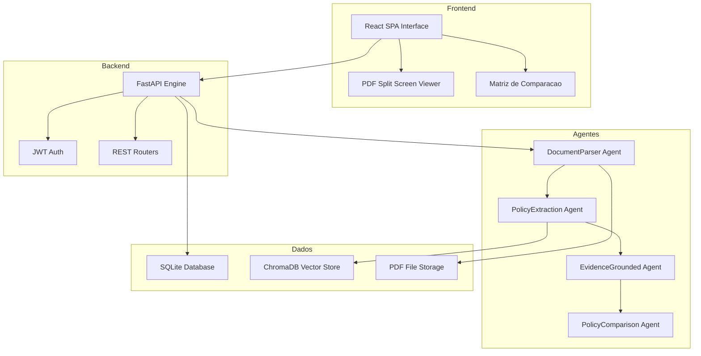
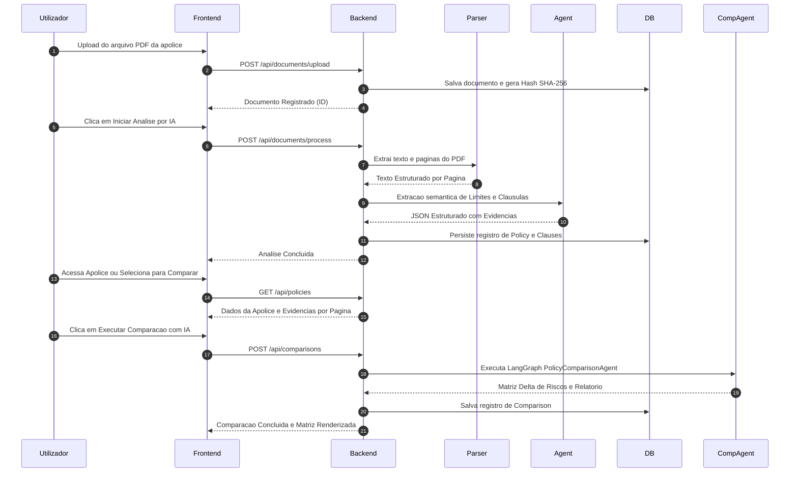

# 📄 Relatório Técnico: D&O Intelligence — Análise e Comparação de Apólices

---

### 🎓 Identificação do Projeto

| Campo | Detalhe |
| :--- | :--- |
| **Curso** | InsurMinds — Inteligência Artificial Aplicada a Seguros |
| **Instituição** | Instituto de Inteligência Artificial (I2A2) |
| **Desafio** | Projeto Final — Plataforma Inteligente para Análise e Comparação de Apólices D&O |
| **Grupo** | IA Journey |
| **Participante** | Arsénio António Monjane |
| **Email** | monjearse@hotmail.com |
| **Data** | Outubro / 2026 |
| **Versão** | 1.0.0 (MVP Produção) |

---

## 1. 🎯 Resumo Executivo

O **D&O Intelligence** é uma plataforma inteligente e auditável projetada para o mercado de seguros corporativos (InsurTech). O seu propósito fundamental é automatizar o processo crítico e moroso de leitura, extração de dados estruturados e análise comparativa de **Apólices de Seguro D&O (Directors and Officers Liability)**.

Apólices D&O são instrumentos jurídicos altamente complexos, compostos por Condições Particulares, Condições Gerais, Endossos e Tabelas de Limites/Franquias. O processo tradicional de análise exige horas de especialistas para identificar a amplitude de coberturas (Side A — Proteção Individual dos Administradores, Side B — Reembolso à Sociedade, Side C — Entidade/Valores Mobiliários), franquias aplicáveis, sublimites de gestão de crise e exclusões críticas.

O **D&O Intelligence** resolve esta ineficiência através de uma arquitetura baseada em **Agentes de Inteligência Artificial, OCR Avançado (PyMuPDF), Vector Store (ChromaDB) e um Parser Híbrido (Regex + Pydantic Agent)**. A plataforma garante **100% de rastreabilidade (grounded proof)**, permitindo que cada campo ou cláusula extraída seja auditada lado a lado com a página exata do PDF original em uma interface split-screen responsiva.

---

## 2. 🏛️ Arquitetura da Solução

A solução foi desenvolvida com base numa arquitetura desacoplada em 4 camadas principais:
1. **Camada de Apresentação (Frontend SPA)**: Desenvolvida em React 18, Vite 5, TailwindCSS e Material Symbols/Lucide, oferecendo uma experiência de utilizador fluida, suporte completo a Dark Mode, leitores de PDF e componentes de progresso visual em tempo real.
2. **Camada de Serviços e API (Backend FastAPI)**: Interface RESTful responsável pelo roteamento, gestão transacional da base de dados, autenticação JWT e orquestração dos fluxos de trabalho.
3. **Camada Agêntica e RAG (LangGraph & Pydantic Agent)**: Motor de raciocínio encarregado da análise semântica, vetorização de cláusulas em ChromaDB e execução do pipeline agêntico de extração e comparação.
4. **Camada de Persistência (Database & Storage)**: Armazenamento relacional em SQLite (SQLAlchemy ORM) para persistência de apólices, cláusulas, comparações e logs de auditoria, integrado ao armazenamento local de arquivos PDF submetidos.

### 2.1 Diagrama de Arquitetura do Sistema

---

## 3. 🤖 Descrição dos Agentes Desenvolvidos

O núcleo de inteligência da plataforma é composto por **5 Agentes Especializados**, desenhados para operar com responsabilidades estritas e saídas estruturadas.

### 3.1 Tabela Resumo dos Agentes

| # | Nome do Agente | Função Principal | Tecnologia / Tool Base |
|---|---|---|---|
| 1 | **DocumentParserAgent** | Ingestão, higienização e extração estruturada de páginas do PDF | `PyMuPDF (fitz)` + OCR Engine |
| 2 | **PolicyExtractionAgent** | Extração semântica de limites, franquias, prêmio, retroatividade e cláusulas | `Pydantic Agent` + LLM (Gemini) |
| 3 | **EvidenceGroundedAgent** | Mapeamento e vinculação de evidências textuais com número da página | `Regex Search` + Anchor Matcher |
| 4 | **PolicyComparisonAgent** | Execução do benchmark semântico entre Apólice Base vs Comparada | `LangGraph` Orchestrator |
| 5 | **ReportGenerationAgent** | Consolidação do relatório executivo e exportação em HTML/PDF | `Jinja2` + Web Engine |

---

### 3.2 Detalhamento Individual dos Agentes

#### 1. DocumentParserAgent
* **Papel**: Responsável pela primeira etapa da pipeline. Recebe o arquivo PDF ou imagem da apólice, efetua a validação de integridade, gera o hash de auditoria SHA-256 e extrai o texto preservando a numeração de páginas e blocos de layout.
* **Saída**: Lista estruturada de páginas contendo os textos higienizados e metadados de layout.

#### 2. PolicyExtractionAgent
* **Papel**: Utiliza schemas Pydantic rigorosos para instruir o modelo LLM a identificar e categorizar os campos fundamentais da apólice (Número da Apólice, Seguradora, Tomador, Limite de Responsabilidade, Franquias Side A/B/C, Prêmio e Retroatividade) e as cláusulas D&O (Coberturas, Exclusões, Sublimites e Condições Gerais).
* **Saída**: Objeto JSON fortemente tipado contendo os campos da apólice e a lista de cláusulas classificadas.

#### 3. EvidenceGroundedAgent
* **Papel**: Garante que o sistema não produza alucinações. Para cada campo ou cláusula identificada pelo `PolicyExtractionAgent`, este agente busca no texto original a fração exata de texto que comprova a informação (*grounded proof*), indicando a página precisa.
* **Saída**: Tuplas contendo `(campo_ou_clausula, texto_evidencia, numero_pagina)`.

#### 4. PolicyComparisonAgent
* **Papel**: Orquestrado via LangGraph, este agente compara duas apólices previamente processadas. Ele realiza o alinhamento semântico de coberturas equivalentes, analisa deltas de Limites e Franquias e classifica cada diferença em níveis de severidade (*Alto Risco*, *Médio Risco*, *Baixo Risco* ou *Favorável*).
* **Saída**: Matriz de benchmark comparativo com lista de deltas e pontuação de alinhamento.

#### 5. ReportGenerationAgent
* **Papel**: Transforma o resultado da comparação em um relatório executivo consolidado, renderizando tabelas comparativas, gráficos de radar de cobertura e destaques de risco para apresentação ao cliente ou underwriting.
* **Saída**: Relatório em formato interativo HTML/PDF.

---

## 4. 🛠️ Tecnologias Utilizadas

| Camada / Componente | Tecnologia Selecionada | Justificação Técnica |
|---|---|---|
| **Linguagem Principal** | Python 3.12+ | Desempenho otimizado, suporte nativo a bibliotecas de IA e parsing assíncrono |
| **Backend Framework** | FastAPI 0.115 | Alta performance, validação nativa via Pydantic v2 e documentação OpenAPI automática |
| **Motor Agêntico** | LangGraph & Pydantic Agent | Controle determinístico de fluxo, schemas estritos e prevenção contra alucinações |
| **Vetorização & RAG** | ChromaDB | Vector Store leve de alta velocidade para indexação de cláusulas e busca semântica |
| **Engine de PDF / OCR** | PyMuPDF (fitz) + Regex Híbrido | Velocidade de extração extremamente alta com precisão de coordenadas e páginas |
| **Base de Dados** | SQLite + SQLAlchemy ORM | Base de dados relacional leve, ideal para MVPs com isolamento transacional completo |
| **Frontend Framework** | React 18 + Vite 5 | Renderização ultrarrápida com compilação Hot Module Replacement (HMR) |
| **Estilização UI** | TailwindCSS + Material Symbols | Design System B2B moderno com suporte nativo a Dark Mode e micro-animações |
| **Gráficos & Visualização** | Recharts | Renderização de gráficos vetoriais (Radar Chart e Distribuição de Severidades) |

---

### 4.1 🤖 Ferramentas de IA e Desenvolvimento Utilizadas

Para a conceção, arquitetura, prototipagem e implementação da plataforma **D&O Intelligence**, foram utilizadas as seguintes ferramentas avançadas de IA e apoio ao desenvolvimento:

| Ferramenta / Plataforma | Origem | Função e Aplicação no Projeto |
|---|---|---|
| **Antigravity** | Google DeepMind Agentic Assistant | Pair programming autónomo, refatoração de código (Python, FastAPI, React, TypeScript), execução de testes automatizados, diagnóstico de erros e manutenção da documentação técnica e checkpoints. |
| **Google Stitch** | Google UI Lab | Prototipagem rápida da interface de utilizador (UI/UX) e apoio na estruturação dos componentes React e gráficos TailwindCSS. |
| **Claude AI** | Anthropic | Raciocínio de engenharia de prompts para classificação de cláusulas D&O e definição dos critérios semânticos de severidade de risco. |
| **ChatGPT** | OpenAI | Geração de apólices sintéticas fictícias em PDF (ex: `POL-DO-2025-010.pdf`) para validação rigorosa dos motores de OCR e RAG. |
| **NotebookLM** | Google Labs | Síntese de documentação, estruturação do conhecimento técnico e apoio na redação do roteiro de vídeo. |
| **CapCut** | ByteDance | Edição de vídeo, sincronização de áudio, legendagem e pós-produção do vídeo demonstrativo. |

---

## 5. 🔄 Fluxo completo de processamento (End-to-End)

O diagrama de sequência abaixo detalha todo o ciclo de vida do dado, desde o upload do contrato até a visualização auditada e comparação:

---

## 6. ⚖️ Justificativa das Decisões Arquiteturais

1. **Parser Híbrido (Regex + LLM Agêntico)**:
   * *Decisão*: Utilizar Regex para extração de campos estruturados padrão (ex: `R$ 35.000.000,00` em Limites) e reservar a LLM para análise semântica de cláusulas complexas (Exclusões, Coberturas).
   * *Justificativa*: Garante **determinismo absoluto** e custo computacional reduzido em campos numéricos, mantendo a capacidade adaptativa do modelo de linguagem para trechos jurídicos ambíguos.

2. **Interface Split-Screen com Evidence Grounding**:
   * *Decisão*: Exibir o PDF original ao lado dos dados extraídos, com navegação automática para a página correspondente.
   * *Justificativa*: No setor de seguros, a confiança no sistema é mandatória. Agentes de IA que operam como "caixa-preta" são rejeitados por underwriters. O *evidence grounding* fornece prova documental auditável para cada valor extraído.

3. **Arquitetura Desacoplada (FastAPI + React)**:
   * *Decisão*: Separação total entre a API RESTful em Python e a SPA em React.
   * *Justificativa*: Permite a evolução independente das camadas. O backend pode ser integrado a sistemas legados de seguradoras (Core Insurance/ERP) via REST API, enquanto a interface web pode sofrer otimizações de UX sem impactar os agentes de IA.

4. **Persistência Relacional com SQLite + SQLAlchemy**:
   * *Decisão*: Escolha do SQLite para o MVP com abstração via SQLAlchemy ORM.
   * *Justificativa*: Facilidade de implantação em ambientes locais ou de demonstração, sem necessidade de servidores de base de dados externos pesados, garantindo ao mesmo tempo uma transição transparente para PostgreSQL em ambiente de produção enterprise.

---

## 7. ⚠️ Limitações Conhecidas

1. **Documentos Digitalizados de Baixa Qualidade (Scans Ruins)**:
   * PDFs resultantes de fotocópias antigas ou com rotações acentuadas podem apresentar pequenas degradações na taxa de precisão do PyMuPDF nativo, necessitando de uma etapa prévia de pré-processamento de imagem (deskew/denoise via OpenCV).
2. **Context Window em Apólices Extremamente Longas**:
   * Apólices que ultrapassam 200 páginas exigem estratégias mais agressivas de chunking vetorial em ChromaDB para evitar estouro de janela de contexto do LLM.
3. **Escopo Focado em D&O (Directors and Officers)**:
   * A ontologia de extração e os critérios de severidade do `PolicyComparisonAgent` foram otimizados especificamente para o ramo D&O. Outros ramos (ex: E&O, Garantia, Patrimonial) necessitam da adição de novos schemas Pydantic específicos.

---

## 8. 🚀 Possibilidades de Evolução Futura

1. **Suporte Multi-Ramo Extensível**:
   * Expansão da ontologia de extração agêntica para cobrir apólices de **E&O (Errors & Omissions)**, **Cyber Risks**, **Garantia** e **Responsabilidade Civil Geral**.
2. **Integração Nativa com Core Insurance Systems**:
   * Criação de conectores bi-direcionais via Webhooks/REST para sistemas como Guidewire, SAP Insurance ou Salesforce Financial Services Cloud.
3. **Execução com SLMs On-Premise (Privacidade de Dados)**:
   * Possibilidade de executar a pipeline de extração utilizando modelos de linguagem pequenos locais (ex: Llama 3 8B, Mistral 7B) em servidores privados da seguradora, atendendo a exigências rigorosas de compliance e regulamentação de dados sigilosos.
4. **Comunicação em Tempo Real via WebSockets**:
   * Substituição do polling de status do frontend por conexões WebSockets para transmissão de progresso streaming página por página durante análises de documentos de grande porte.

---
*Relatório técnico final gerado em Outubro de 2026.*  
*Projeto D&O Intelligence — Especialização InsurMinds (I2A2).*
