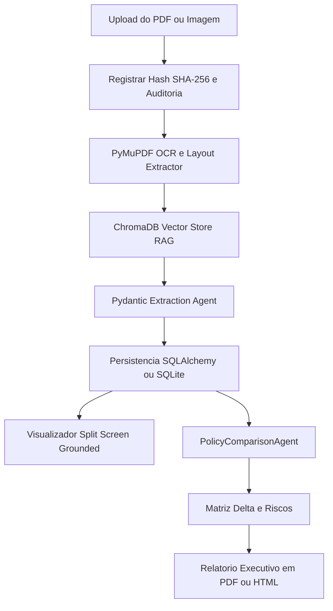

# 🛡️ D&O Intelligence — Plataforma Inteligente para Análise e Comparação de Apólices D&O

**Projeto Final** | InsurMinds — Inteligência Artificial Aplicada a Seguros (I2A2)

[](https://python.org)
[](https://fastapi.tiangolo.com)
[](https://langchain-ai.github.io/langgraph/)
[](https://react.dev)
[](https://vitejs.dev)
[](https://sqlite.org)
[](https://opensource.org/licenses/MIT)

---

## 📋 Visão Geral & Contexto

Apólices de seguro **D&O (Directors & Officers Liability)** são documentos extremamente longos, complexos e redigidos em linguagem jurídica altamente especializada. Comparar diferentes contratos exige a identificação precisa de:
- **Limites Máximos de Responsabilidade (LMR)** principais e sublimites por sinistro/agregados;
- **Estrutura de Franquias e Retenções Próprias** (Side A — Diretores Pessoas Físicas, Side B — Reembolso Corporativo à Sociedade e Side C — Valores Mobiliários);
- **Coberturas Principais, Adicionais e Endossos**;
- **Exclusões Críticas** (Atos Dolosos/Fraude, Poluição, Severabilidade e Conduta);
- **Regime Temporal e Retroatividade** (Claims Made).

Este processo demanda tradicionalmente diversas horas de trabalho minucioso por underwriters e corretores especialistas. 

O **D&O Intelligence** é uma plataforma baseada em **Inteligência Artificial Generativa e Arquitetura Agêntica** projetada para automatizar, auditara e comparar apólices D&O com 100% de rastreabilidade e precisão grounded.

---

## 🎯 Objetivos do Projeto Final

1. **Demonstrar uma Arquitetura Consistente**: Integrar OCR, LLMs, Agentes Inteligentes, Banco de Dados Vetorial/Relacional e Interfaces Modernas.
2. **Extração Automática com Rastreabilidade**: Extrair termos, limites, franquias e cláusulas diretamente de arquivos PDF/Imagem com direcionamento para a página exata da evidência no documento.
3. **Matriz de Benchmark & Comparação D&O**: Executar comparações semânticas entre duas apólices (Base vs Comparada), identificando deltas de cobertura e severidades de risco (Alto, Médio, Baixo).
4. **Interface de Auditoria Split-Screen**: Permitir ao especialista visualizar a apólice original lado a lado com os insights extraídos pela IA.

---

## 🏗️ Arquitetura do Sistema & Pipeline de Agentes

O workflow combina OCR nativo PyMuPDF, indexação RAG em ChromaDB e orquestração de Agentes Pydantic via LangGraph:



---

## 🛠️ Stack Tecnológica

| Camada | Tecnologia / Biblioteca | Função no Sistema |
|---|---|---|
| **Backend** | Python 3.12+, FastAPI 0.115, Uvicorn | API RESTful com roteamento modular e documentação OpenAPI |
| **IA & Orquestração** | LangGraph, Pydantic Agent v2, ChromaDB | Agentes de extração semântica e comparação contratual D&O |
| **Processamento de PDF** | PyMuPDF (fitz), Regex Engine Híbrido | OCR, extração de texto estruturado e layout por página |
| **Base de Dados** | SQLite (SQLAlchemy ORM) | Persistência relacional de apólices, cláusulas, comparações e logs |
| **Frontend** | React 18, TypeScript, Vite 5, TailwindCSS | Interface SPA responsiva com tema Dark Mode e visualização de PDF |
| **Visualização de Dados** | Recharts, Material Symbols | Gráficos de Radar de cobertura e Distribuição de Riscos |

---

### Ferramentas de IA e Apoio ao Desenvolvimento Utilizadas

| Ferramenta / Plataforma | Origem | Aplicação no Projeto |
|---|---|---|
| **Antigravity** | Google DeepMind Agentic Assistant | Pair programming autónomo, refatoração de código, testes de integração automatizados e gestão da documentação técnica e checkpoints. |
| **Google Stitch** | Google UI Lab | Prototipagem rápida de interface e componentes gráficos React + Tailwind. |
| **Claude AI** | Anthropic | Engenharia de prompts para classificação de cláusulas D&O e severidade de riscos. |
| **ChatGPT** | OpenAI | Apoio na criação de documentos sintéticos para validação de OCR (`POL-DO-2025-010.pdf`). |
| **NotebookLM** | Google Labs | Síntese de documentação, estruturação de conhecimentos e apoio na elaboração do roteiro de apresentação. |
| **CapCut** | ByteDance | Edição de vídeo, legendagem automática e pós-produção da apresentação do projeto. |

---

## 📂 Estrutura do Projeto

```
DO Insight — Intelligent Policy Analysis/
├── init_project.py           # Script principal de inicialização e launcher unificado
├── init_project.bat          # Launcher Windows Batch
├── create_frontend.bat       # Script auxiliar para setup do frontend
├── create_pitch_deck.py      # Script de automação e geração do Pitch Deck PPTX (16:9)
├── README.md                 # Documentação principal do Projeto Final
│
├── Projeto_Final_Artefatos/  # Diretório centralizado de artefatos finais da entrega
│   ├── DO Intelligence.mp4                  # Vídeo oficial de demonstração e pitch executivo
│   ├── CapaVideo.png                        # Miniatura / Capa oficial do vídeo de apresentação
│   ├── DO Intelligence-Cover.jpg            # Imagem de capa oficial da solução
│   ├── D&O Intelligence_ Smart Policy Insights.png # Banner institucional e arte gráfica
│   ├── InsurMinds_Projeto_Final.pptx        # Apresentação Pitch Deck (PowerPoint 16:9)
│   ├── relatorio_tecnico.md                 # Relatório Técnico completo do sistema
│   ├── roteiro_bloco_A_pitch_executivo.md   # Roteiro de Vídeo - Bloco A (Pitch 2m30s)
│   ├── roteiro_bloco_B_demonstracao_pratica.md # Roteiro de Vídeo - Bloco B (Demo 2m30s)
│   ├── roteiro_video_apresentacao.md        # Índice mestre dos roteiros de vídeo
│   ├── Prompts/                             # Prompts base e especificações de agentes
│   └── demo_menus/                          # Protótipos de interface e mockups de menus
│
├── do-intelligence/
│   ├── backend/              # Aplicação Backend FastAPI
│   │   ├── app/
│   │   │   ├── agents/       # Agentes de IA e Orquestrador
│   │   │   │   ├── orchestrator.py             # Orquestrador da pipeline de análise
│   │   │   │   ├── document_agent.py           # Ingestão, PyMuPDF e OCR resiliente
│   │   │   │   ├── policy_extraction_agent.py  # Extração estruturada de apólice (Pydantic)
│   │   │   │   ├── clause_intelligence_agent.py# Classificação e análise de cláusulas D&O
│   │   │   │   ├── policy_comparison_agent.py  # Comparação semântica e matriz delta
│   │   │   │   ├── risk_insight_agent.py       # Avaliação de severidade e riscos
│   │   │   │   └── report_agent.py             # Agente gerador de relatórios executivos
│   │   │   ├── api/          # Endpoints FastAPI RESTful
│   │   │   │   ├── documents.py    # Upload e processamento de apólices
│   │   │   │   ├── policies.py     # Gestão e consulta detalhada de apólices
│   │   │   │   ├── comparisons.py  # Execução e histórico de comparações
│   │   │   │   ├── reports.py      # Geração de relatórios executivos (PDF/HTML)
│   │   │   │   ├── audit.py        # Trilhas de auditoria e evidências
│   │   │   │   ├── logs.py         # Consulta de logs de execução e eventos
│   │   │   │   ├── settings.py     # Parâmetros e observabilidade do sistema
│   │   │   │   └── health.py       # Monitoramento de status dos serviços
│   │   │   ├── core/         # Configurações globais, banco de dados e segurança
│   │   │   │   ├── config.py       # Variáveis de ambiente e paths (UPLOAD_DIR)
│   │   │   │   ├── db.py           # Conexão e sessão SQLAlchemy
│   │   │   │   └── security.py     # Autenticação e tokens JWT
│   │   │   ├── llm/          # Provedores de LLM e modo mock defensivo
│   │   │   ├── rag/          # Vector Store (ChromaDB) e indexação de embeddings
│   │   │   ├── models/       # Modelos SQLAlchemy (Document, Policy, Clause, Comparison, etc.)
│   │   │   └── main.py       # Ponto de entrada do FastAPI
│   │   ├── data/             # Banco de dados SQLite (`do_intelligence.db`) e ChromaDB
│   │   ├── uploads/          # Armazenamento de apólices submetidas (PDF / Imagens)
│   │   └── requirements.txt  # Dependências Python do backend
│   │
│   └── frontend/             # Aplicação Frontend React 18 + Vite + TailwindCSS
│       ├── src/
│       │   ├── api.ts        # Cliente Axios com timeouts otimizados para RAG/IA
│       │   ├── Layout.tsx    # Shell com Sidebar retrátil, Header e navegação
│       │   ├── ThemeContext.tsx # Gestão dinâmica de tema (Light / Dark Mode)
│       │   ├── theme.ts      # Tokens de design e paleta de cores
│       │   ├── vite-env.d.ts # Declaração de tipagem Vite Client
│       │   └── pages/        # Telas da plataforma
│       │       ├── Dashboard.tsx      # Visão geral executiva e métricas
│       │       ├── NewAnalysis.tsx    # Upload, progresso de IA e histórico recente
│       │       ├── Policies.tsx       # Catálogo e listagem de apólices analisadas
│       │       ├── PolicyDetail.tsx   # Visualização Split-Screen e cláusulas grounded
│       │       ├── Comparisons.tsx    # Matriz comparativa Side-by-Side e Radar
│       │       ├── EvidenceAudit.tsx  # Trilha de auditoria e evidências textuais
│       │       ├── Reports.tsx        # Emissão de relatórios executivos de benchmark
│       │       ├── Logs.tsx           # Logs de sistema e eventos em tempo real
│       │       └── Settings.tsx       # Configuração de IA, provedores e sistema
│       ├── package.json
│       ├── tailwind.config.js
│       └── vite.config.ts
│
└── Planos/                   # Registro e histórico de checkpoints do projeto (CHK26...)
```

---

## ⚙️ Configuração de Variáveis de Ambiente (.env)

O backend do sistema utiliza um arquivo `.env` localizado na pasta `do-intelligence/backend/` como a **única fonte de verdade** para chaves de API, credenciais e parâmetros de execução.

### Exemplo de Configuração (`do-intelligence/backend/.env`)

Para configurar o ambiente de desenvolvimento, copie o arquivo de exemplo `.env.example` para `.env`:

```powershell
# No PowerShell / Terminal
cd "do-intelligence/backend"
copy .env.example .env
```

Conteúdo do arquivo `.env`:

```env
# Provedor LLM & Chaves de API (OpenRouter / Gemini)
OPENROUTER_API_KEY=sk-or-v1-sua_chave_aqui
OPENROUTER_BASE_URL=https://openrouter.ai/api/v1
OPENROUTER_MODEL=google/gemini-2.5-flash

# Base de Dados Relacional SQLite
DATABASE_URL=sqlite:///./data/insurance_policie_analysis.db
SQLITE_DB=insurance_policie_analysis.db

# Segurança & Autenticação JWT
SECRET_KEY=sua_chave_secreta_jwt_para_desenvolvimento
ALGORITHM=HS256
ACCESS_TOKEN_EXPIRE_MINUTES=60

# Provedores de OCR e Idioma
OCR_PROVIDER=pymupdf
LLM_PROVIDER=openrouter
LANG=pt
```

### Descrição dos Parâmetros

| Variável | Descrição | Valor Padrão / Exemplo |
|---|---|---|
| `OPENROUTER_API_KEY` | Chave de autenticação para a API do OpenRouter/Gemini | `sk-or-v1-...` |
| `OPENROUTER_BASE_URL` | URL base para chamadas ao modelo LLM | `https://openrouter.ai/api/v1` |
| `OPENROUTER_MODEL` | Identificador do modelo LLM utilizado pelos agentes | `google/gemini-2.5-flash` |
| `DATABASE_URL` | Connection String SQLAlchemy da base de dados SQLite | `sqlite:///./data/insurance_policie_analysis.db` |
| `SECRET_KEY` | Chave criptográfica para validação de tokens JWT | Chave estática ou gerada |
| `OCR_PROVIDER` | Motor de OCR utilizado (`pymupdf`, `tesseract` ou `mock`) | `pymupdf` |
| `LANG` | Idioma de extração e suporte aos prompts | `pt` |

> ⚠️ **Nota de Segurança**: Nunca comite o arquivo `.env` contendo chaves de API reais para o repositório público. O arquivo `.env` já está incluído no `.gitignore`.

---

## ⚡ Instalação e Execução

### Pré-requisitos
- **Python 3.12+** instalado
- **Node.js 18+** & **npm** instalados

---

### Opção 1 — Launcher Unificado (Recomendado)

O projeto possui um inicializador em Python que prepara as dependências, verifica o banco de dados e abre os serviços automaticamente:

```powershell
# Executar a partir da raiz do projeto
python init_project.py
```

Ou via terminal Windows Command Prompt:

```cmd
init_project.bat
```

O launcher irá:
1. Validar a estrutura do projeto e arquivos de checkpoint;
2. Instalar automaticamente as dependências Python (`backend/requirements.txt`);
3. Instalar as dependências do React (`frontend/node_modules`);
4. Inicializar o banco de dados SQLite caso ainda não exista;
5. Iniciar o servidor Backend FastAPI na porta `8000` e o Frontend Vite na porta `5173`;
6. Abrir o navegador automaticamente em **http://localhost:5173**.

---

### Opção 2 — Execução Manual em Terminais Separados

#### 1. Backend (FastAPI)

```powershell
cd "do-intelligence/backend"
python -m venv .venv
.venv\Scripts\Activate.ps1
pip install -r requirements.txt

# Iniciar servidor
python main.py
```
> O backend estará acessível em `http://localhost:8000` e a documentação interativa em `http://localhost:8000/docs`.

#### 2. Frontend (React + Vite)

```powershell
cd "do-intelligence/frontend"
npm install
npm run dev
```
> O frontend estará acessível em `http://localhost:5173`.

---

## 🌐 Endereços e Acesso aos Serviços

| Serviço | URL |
|---|---|
| **Interface Web (Frontend)** | http://localhost:5173 |
| **API Backend (FastAPI)** | http://localhost:8000 |
| **Swagger UI (Documentação OpenAPI)** | http://localhost:8000/docs |
| **ReDoc (Documentação Alternativa)** | http://localhost:8000/redoc |

---

## 📊 Endpoints Principais da API Backend

| Método | Endpoint | Descrição |
|---|---|---|
| `GET` | `/api/health` | Verificação de status do servidor backend e banco de dados |
| `POST` | `/api/documents/upload` | Upload de arquivo PDF/Imagem de apólice |
| `POST` | `/api/documents/{id}/process` | Executa a pipeline de OCR, RAG e extração semântica |
| `GET` | `/api/policies` | Lista todas as apólices cadastradas com filtros e data/hora de análise |
| `GET` | `/api/policies/{id}` | Detalhes completos da apólice (coberturas, exclusões, limites e franquias) |
| `POST` | `/api/comparisons` | Executa a comparação entre duas apólices via `PolicyComparisonAgent` |
| `GET` | `/api/comparisons` | Histórico de comparações com busca e paginação |
| `GET` | `/api/reports/{id}` | Gera o relatório executivo de benchmark em HTML/PDF |

---

## 🎓 Informações Acadêmicas e Autoria

Este projeto foi desenvolvido como **Desafio Final** de especialização acadêmica:

| Campo | Detalhe |
|---|---|
| **Curso** | InsurMinds — Inteligência Artificial Aplicada a Seguros |
| **Instituição** | Instituto de Inteligência Artificial I2A2 |
| **Desafio** | Projeto Final — Plataforma Inteligente para Análise e Comparação de Apólices D&O |
| **Grupo** | IA Journey |
| **Participante** | Arsénio António Monjane |
| **Email** | monjearse@hotmail.com |
| **Data de Conclusão** | Outubro / 2026 |

---

## 📜 Licença

Este projeto está sob a licença **MIT** — consulte o arquivo LICENSE para mais detalhes.

*Projeto Acadêmico I2A2 — InsurMinds 2026*
